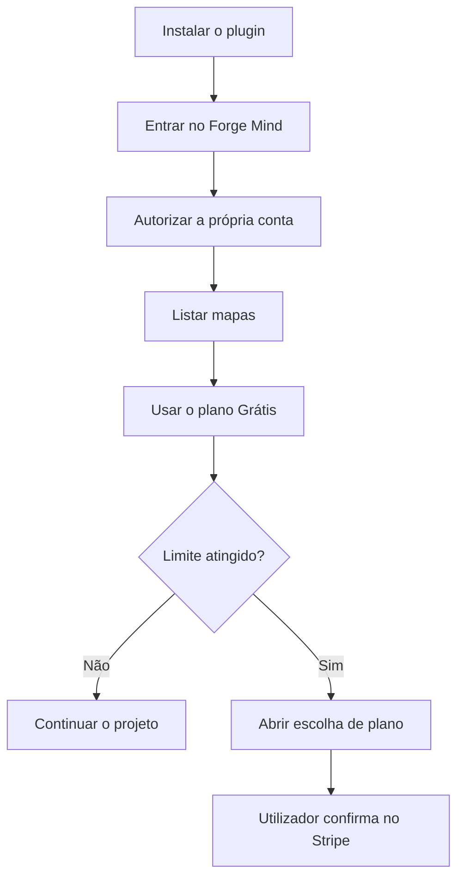

<div align="center">
  

  <p><strong>Os teus agentes trabalham. O Forge Mind lembra-se.</strong></p>
  <p>Guarda decisões, ideias, ficheiros e próximos passos num mapa visual que a tua IA consegue consultar e atualizar.</p>

  <p>
    <a href="https://mind.forgelabs.pt">Abrir Forge Mind</a>
    ·
    <a href="https://mind.forgelabs.pt/planos">Ver planos</a>
    ·
    <a href="https://mind.forgelabs.pt/support.html">Suporte</a>
  </p>
</div>

## O que este plugin faz

O Forge Mind liga o teu agente ao mapa dos teus projetos. Antes de agir, o agente pode consultar o que já existe. Depois do trabalho, pode guardar decisões e próximos passos no lugar certo.

| Sem Forge Mind | Com Forge Mind |
|---|---|
| Procurar o chat antigo | Abrir o mapa do projeto |
| Explicar tudo novamente | Continuar do ponto onde paraste |
| Ideias espalhadas | Cards ligados por contexto |
| Decisões perdidas | Histórico visual e pesquisável |

## Instalação

### Codex e ChatGPT desktop

Adiciona o marketplace oficial:

```bash
codex plugin marketplace add Ricoandrade1/forge-mind-agent
codex plugin add forge-mind@forge-labs
```

Depois conclui a ligação segura da tua conta quando o cliente pedir a credencial. Também podes abrir a área de Plugins para confirmar que **Forge Mind** aparece como instalado.

### Outros clientes MCP

Usa o servidor remoto:

```text
https://mcp-forgemind.forgelabs.pt/mcp
```

Cria uma chave pessoal em [Ligar o meu agente](https://mind.forgelabs.pt/#app/ligar-agente) e coloca-a apenas no campo seguro do cliente como Bearer token. Nunca publiques a chave numa conversa ou ficheiro do projeto.

## Fluxo do utilizador



## Upgrade no momento certo

Quando um limite é atingido, o agente recebe uma resposta estruturada com `upgrade_required` e um link seguro. Ele abre a página de planos quando o cliente permite, ou mostra o link clicável. Nada é apagado e nenhuma compra é feita automaticamente.

O utilizador escolhe entre Essencial e Pro e confirma o pagamento no Stripe.

## Ferramentas principais

| Ferramenta | Ação |
|---|---|
| `list_maps` | Lista os mapas autorizados |
| `get_map` | Lê cards, ligações e anexos |
| `create_map` | Cria uma nova área |
| `create_card` | Cria um projeto ou subcard |
| `update_card` | Atualiza notas, tags e links |
| `connect_cards` | Liga dois cards relacionados |
| `organize_map` | Reorganiza o mapa visual |
| `get_upgrade_options` | Abre a escolha de plano quando necessário |

## Planos

| Plano | Preço | Uso principal |
|---|---:|---|
| Grátis | 0 € | Começar com até 5 cards |
| Essencial | 5,90 €/mês | Até 10 cards principais, com subcards fora do limite |
| Pro | 9,90 €/mês | Cards principais ilimitados e mais automação |

[Comparar planos e pagamento anual](https://mind.forgelabs.pt/planos)

## Privacidade e segurança

- O agente acede apenas à conta autorizada.
- As chaves devem ser guardadas no campo seguro do cliente.
- O plugin nunca pede senha ou token dentro da conversa.
- Uma gravação só é confirmada depois da resposta da ferramenta.
- O pagamento é sempre escolhido e confirmado pelo utilizador.

Consulta a [Política de Privacidade](https://mind.forgelabs.pt/privacy.html), os [Termos de Utilização](https://mind.forgelabs.pt/terms.html) e a [Política de Reembolsos](https://mind.forgelabs.pt/refunds.html).

## Estrutura do repositório

```text
.
├── .agents/plugins/marketplace.json
├── plugins/forge-mind
│   ├── plugin.json
│   ├── mcp.json
│   ├── assets
│   └── skills
└── README.md
```

## Forge Labs

Produto criado pela [Forge Labs](https://forgelabs.pt), em Braga, Portugal.

## Licença

O pacote de instalação deste repositório usa a licença MIT. O serviço Forge Mind, a infraestrutura e os dados dos utilizadores continuam sujeitos aos termos do produto.
