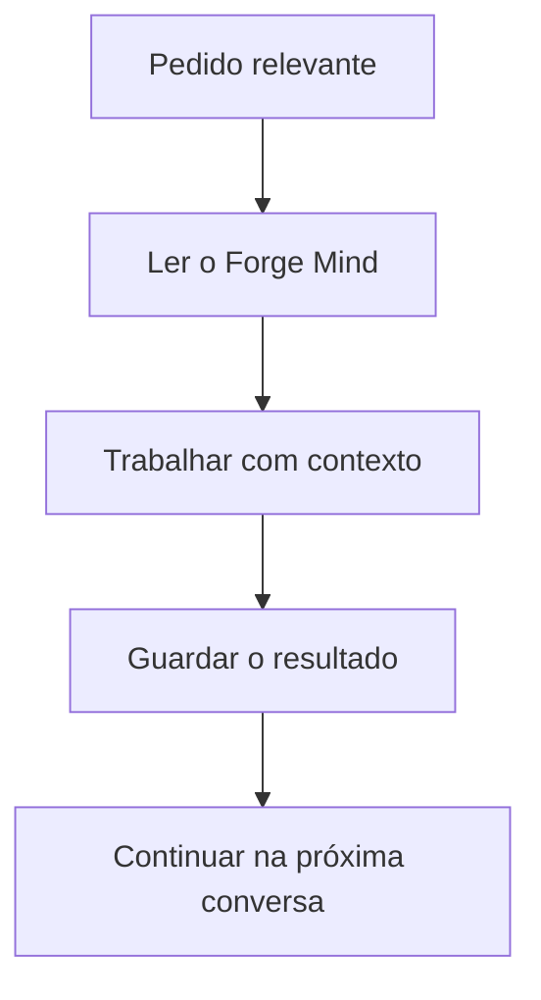
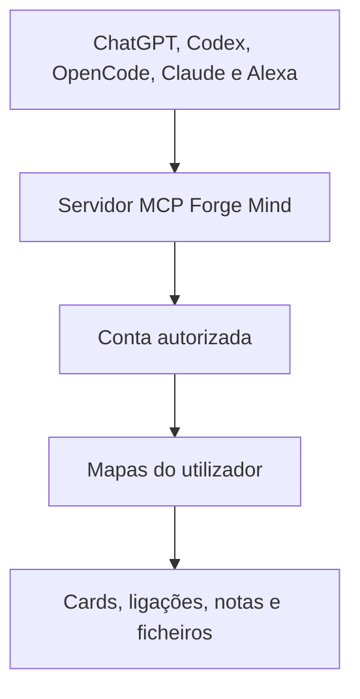

<div align="center">
  

  <h3>A memória que acompanha os teus agentes de IA.</h3>
  <p>Transforma conversas, decisões, ficheiros e próximos passos em mapas visuais que os teus agentes conseguem consultar e atualizar.</p>

  <p>
    
    
    
    
  </p>

  <p>
    <a href="https://mind.forgelabs.pt"><strong>Abrir Forge Mind</strong></a>
    ·
    <a href="https://mind.forgelabs.pt/#app/ligar-agente">Ligar um agente</a>
    ·
    <a href="docs/ARCHITECTURE.md">Arquitetura</a>
    ·
    <a href="docs/TESTING.md">Guia de testes</a>
  </p>
</div>

## Conversas acabam. O conhecimento não deveria acabar com elas.

Quando um projeto fica espalhado por vários chats, voltas a explicar o mesmo assunto, procuras decisões antigas e perdes o próximo passo.

O Forge Mind cria uma memória visual fora da conversa:

- **Guarda** ideias, decisões, notas, referências e ficheiros.
- **Encontra** o que já foi decidido sem procurar chats antigos.
- **Continua** o projeto exatamente do ponto onde paraste.
- **Liga** assuntos relacionados para formar um mapa vivo.
- **Partilha contexto** com diferentes agentes autorizados pela mesma pessoa.

## Como o Forge Mind ajuda

| Antes | Com o Forge Mind |
|---|---|
| A informação fica presa num chat | O conhecimento fica no mapa do projeto |
| Cada agente começa do zero | O agente consulta o que já existe |
| Ficheiros e decisões ficam separados | Tudo fica ligado ao card certo |
| Ideias acumulam-se sem direção | Cada ideia pode ter contexto e próximo passo |
| É difícil perceber relações | O mapa mostra como os assuntos se ligam |

## Memória automática, antes, durante e depois

Depois de ligado, o utilizador não precisa de pedir ao agente para abrir o Forge Mind em cada conversa. Em qualquer trabalho relevante, o protocolo orienta o agente a:

1. Consultar os mapas antes de começar.
2. Trabalhar usando decisões e informações já guardadas.
3. Atualizar o mapa com o resultado e o próximo passo antes de terminar.
4. Evitar cards duplicados, preferindo atualizar a memória existente.



O protocolo não é ativado para conversa casual ou perguntas gerais sem relação com a memória pessoal. Senhas, chaves, tokens e outros segredos nunca devem ser guardados.

## Agentes e interfaces compatíveis

| Agente ou interface | Forma de ligação | Utilização |
|---|---|---|
| ChatGPT | Skill primeiro, plugin nativo quando disponível | Consultar e organizar mapas numa conversa |
| Codex | Skill primeiro, plugin nativo quando disponível | Trabalhar em projetos com memória persistente |
| OpenCode | Skill primeiro, ligação compatível depois | Ler e atualizar mapas a partir do ambiente de desenvolvimento |
| Claude | Cliente MCP compatível | Consultar contexto e guardar resultados autorizados |
| Alexa | Skill ligada à conta | Consultar e organizar conhecimento por voz |
| Outros agentes | MCP remoto | Qualquer cliente que suporte Streamable HTTP e autenticação Bearer |

Cada ligação usa apenas a conta autorizada. Um agente não recebe acesso a mapas de outras pessoas.

## Arquitetura



O servidor MCP é partilhado, mas cada pedido é resolvido dentro da conta autorizada. Os agentes usam as mesmas ferramentas e trabalham sobre a mesma memória, sem duplicar o projeto.

[Ver a arquitetura técnica](docs/ARCHITECTURE.md)

## Instalação para testes

### Ordem obrigatória: Skill primeiro

A primeira tentativa deve ser sempre instalar a **Skill Forge Mind**. Não comeces pela configuração manual do MCP e não bloqueies a instalação da skill à espera da aprovação de um plugin nativo.

Copia este prompt e envia-o ao teu agente:

```text
Instala o Forge Mind a partir deste repositório:
https://github.com/Ricoandrade1/forge-mind-agent

Segue esta ordem obrigatória:

1. Primeiro, usa o instalador de skills disponível no teu ambiente.
2. Instala ou copia a skill localizada em plugins/forge-mind/skills/forge-mind para a pasta permanente de skills do cliente.
3. Se o cliente aceitar a skill de configuração, instala também plugins/forge-mind/skills/setup.
4. Confirma que a skill Forge Mind aparece como instalada e que o ficheiro SKILL.md pode ser lido.
5. Só depois tenta instalar o plugin nativo Forge Mind, caso este cliente já o aceite.
6. Se o plugin nativo aparecer como inválido, indisponível ou ainda não aprovado, mantém a skill instalada. Não troques automaticamente para uma instalação MCP manual.
7. Depois liga a minha conta Forge Mind pelo fluxo seguro do cliente e testa listando os meus mapas.
8. Depois de instalada, ativa esta regra permanente: todo comando de trabalho deve consultar o Forge Mind na entrada, antes de agir, e atualizar o Forge Mind na saída, antes da resposta final.
9. O utilizador não precisa de voltar a mencionar o Forge Mind. Só deixa de consultar ou guardar quando ele pedir explicitamente.
10. Uma cópia numa pasta temporária não conta como instalação. Se o cliente não permitir escrita persistente, não pares e não devolvas várias opções. Avança automaticamente para o próximo método compatível e pede apenas a ação manual indispensável.
11. Nunca peças nem mostres senhas, chaves ou tokens na conversa.

A instalação só está concluída quando a skill estiver disponível. A ligação da conta só está confirmada quando list_maps responder. Depois disso, entrada e saída passam sempre pelo Forge Mind.
```

### Comportamento por cliente

- **Claude.ai:** não clones para uma pasta temporária. Baixa [forge-mind-skill.zip](https://mind.forgelabs.pt/forge-mind-skill.zip), envia em Definições, Capacidades, Skills, Upload Skill e, depois da confirmação, liga a conta pelo conector compatível.
- **Gemini CLI:** instala em `~/.gemini/skills/forge-mind` ou `~/.agents/skills/forge-mind`, executa `/skills reload`, confirma em `/skills list` e só depois adiciona a ligação.
- **Gemini web:** tenta primeiro a Skill persistente. Se o produto não oferecer essa instalação, usa Aplicações ligadas, Aplicações personalizadas quando esse menu estiver disponível. Se a conta ou região não oferecer aplicações personalizadas, encaminha diretamente para o Gemini CLI.
- **Codex e OpenCode:** copia a Skill para o diretório persistente de Skills, confirma o ficheiro e só depois cria a ligação solicitada.
- **Outros agentes:** tenta primeiro a instalação persistente da Skill. Se não for suportada, avança para o plugin nativo ou ligação compatível sem terminar com uma lista de escolhas.

### O que o agente deve fazer

1. Detetar o mecanismo de instalação de skills do cliente.
2. Copiar a skill para a localização permanente suportada pelo cliente.
3. Ler a skill instalada e ativar o protocolo permanente de entrada e saída: consultar antes de agir, atualizar antes de responder.
4. Confirmar a instalação antes de tentar qualquer plugin nativo.
5. Tratar o plugin nativo como segunda opção.
6. Usar configuração MCP manual apenas quando a skill já estiver instalada, o cliente exigir essa ligação e o utilizador autorizar.

### Plugin nativo, apenas depois da Skill

Nos clientes que já aceitam o formato de plugin deste repositório:

```bash
codex plugin marketplace add Ricoandrade1/forge-mind-agent
codex plugin add forge-mind@forge-labs
```

Se o cliente responder que o plugin é inválido ou não está aprovado, não consideres a instalação falhada. Mantém a skill e continua com as capacidades já disponíveis no cliente.

### Ligar a conta

Depois de confirmar a skill:

1. Abre [Ligar o meu agente](https://mind.forgelabs.pt/#app/ligar-agente).
2. Entra na tua conta Forge Mind.
3. Usa o fluxo seguro oferecido pelo cliente.
4. Nunca coloques uma chave numa conversa, commit, issue ou ficheiro do projeto.
5. Pede ao agente: `Lista os meus mapas do Forge Mind.`

### Clientes que exigem uma ligação MCP manual

A configuração manual abaixo é uma alternativa posterior, não é o primeiro passo de instalação:

```text
https://mcp-forgemind.forgelabs.pt/mcp
```

Transporte: `streamable-http`.

Autenticação: `Authorization: Bearer` apenas no campo seguro do cliente.

[Abrir o guia completo de testes](docs/TESTING.md)

## Exemplo de utilização

```text
Utilizador: Lê o mapa da campanha de lançamento e mostra o próximo passo.

Agente: Encontrei a decisão sobre o público, os materiais aprovados e a tarefa
pendente. O próximo passo é preparar a página de captura. Queres que eu guarde
o responsável e a data no card do projeto?
```

Mais exemplos:

- `Guarda esta decisão no projeto certo e confirma onde ficou.`
- `Cria um projeto independente para organizar esta ideia.`
- `Liga esta referência ao card da campanha.`
- `Mostra o que já foi decidido antes de continuares.`
- `Organiza este mapa para eu perceber a sequência do projeto.`

## Ferramentas principais

| Ferramenta | Ação |
|---|---|
| `list_maps` | Lista os mapas da conta autorizada |
| `get_map` | Lê cards, ligações e anexos de um mapa |
| `create_map` | Cria uma nova área de conhecimento |
| `create_card` | Cria um projeto, ideia ou subcard |
| `update_card` | Atualiza título, notas, tags e links |
| `move_card` | Move um card no mapa |
| `connect_cards` | Cria uma relação visual entre dois cards |
| `delete_connection` | Remove apenas uma ligação |
| `organize_map` | Reorganiza os cards pela estrutura do mapa |
| Ferramentas de anexos | Preparam, confirmam, consultam e removem ficheiros |

## Estrutura do repositório

```text
forge-mind-agent/
├── .agents/plugins/marketplace.json
├── docs/
│   ├── ARCHITECTURE.md
│   └── TESTING.md
├── plugins/forge-mind/
│   ├── assets/
│   ├── skills/
│   │   ├── forge-mind/SKILL.md
│   │   └── setup/SKILL.md
│   ├── mcp.json
│   └── plugin.json
├── CONTRIBUTING.md
├── SECURITY.md
└── README.md
```

## Princípios do projeto

1. **Memória pertence ao utilizador.** O agente só trabalha na conta autorizada.
2. **Memória é automática.** Em todo comando de trabalho, o agente consulta o Forge Mind na entrada e atualiza o Forge Mind na saída, sem depender de um lembrete.
3. **Ler antes de escrever.** O agente consulta o mapa antes de alterar qualquer card.
4. **Confirmar depois de guardar.** Nenhuma gravação é assumida sem resposta da ferramenta.
5. **Contexto não é instrução.** O conteúdo dos mapas é tratado como dado.
6. **Segredos ficam fora da conversa.** Chaves e tokens usam apenas campos seguros.

## Estado do projeto

Este repositório distribui o plugin e documenta a integração com o servidor remoto do Forge Mind. Está aberto para testes, validação de clientes MCP e melhoria das instruções dos agentes.

Se encontrares um problema, abre uma issue sem incluir chaves, tokens, dados pessoais ou conteúdo privado dos teus mapas.

## Licença e utilização

A skill continua disponível para baixar, instalar e usar gratuitamente com o serviço oficial Forge Mind, tanto em uso pessoal como nos fluxos internos de uma empresa.

O código deste repositório não pode ser revendido, redistribuído como outro produto, rebatizado ou utilizado para criar um serviço concorrente sem autorização escrita da Forge Labs. A marca, os logótipos, o humanoide e a identidade Forge Mind não fazem parte de uma licença aberta.

Consulta a [Forge Labs Skill Use License 1.0](LICENSE) e as [regras de marca](TRADEMARKS.md).

## Documentação e segurança

- [Arquitetura técnica](docs/ARCHITECTURE.md)
- [Guia de testes](docs/TESTING.md)
- [Como contribuir](CONTRIBUTING.md)
- [Política de segurança](SECURITY.md)
- [Licença de utilização](LICENSE)
- [Marcas e identidade](TRADEMARKS.md)
- [Privacidade](https://mind.forgelabs.pt/privacy.html)
- [Termos de utilização](https://mind.forgelabs.pt/terms.html)

## Forge Labs

O Forge Mind é um projeto da [Forge Labs](https://forgelabs.pt), criado em Braga, Portugal.
