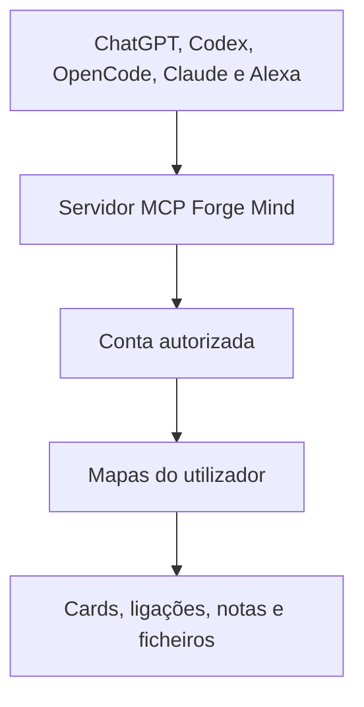

<div align="center">
  

  <h3>A memória que acompanha os teus agentes de IA.</h3>
  <p>Transforma conversas, decisões, ficheiros e próximos passos em mapas visuais que os teus agentes conseguem consultar e atualizar.</p>

  <p>
    
    
    
  </p>

  <p>
    <a href="https://mind.forgelabs.pt"><strong>Abrir Forge Mind</strong></a>
    ·
    <a href="https://mind.forgelabs.pt/#app/ligar-agente">Ligar um agente</a>
    ·
    <a href="docs/ARCHITECTURE.md">Arquitetura</a>
    ·
    <a href="docs/TESTING.md">Guia de testes</a>
  </p>
</div>

## Conversas acabam. O conhecimento não deveria acabar com elas.

Quando um projeto fica espalhado por vários chats, voltas a explicar o mesmo assunto, procuras decisões antigas e perdes o próximo passo.

O Forge Mind cria uma memória visual fora da conversa:

- **Guarda** ideias, decisões, notas, referências e ficheiros.
- **Encontra** o que já foi decidido sem procurar chats antigos.
- **Continua** o projeto exatamente do ponto onde paraste.
- **Liga** assuntos relacionados para formar um mapa vivo.
- **Partilha contexto** com diferentes agentes autorizados pela mesma pessoa.

## Como o Forge Mind ajuda

| Antes | Com o Forge Mind |
|---|---|
| A informação fica presa num chat | O conhecimento fica no mapa do projeto |
| Cada agente começa do zero | O agente consulta o que já existe |
| Ficheiros e decisões ficam separados | Tudo fica ligado ao card certo |
| Ideias acumulam-se sem direção | Cada ideia pode ter contexto e próximo passo |
| É difícil perceber relações | O mapa mostra como os assuntos se ligam |

## Agentes e interfaces compatíveis

| Agente ou interface | Forma de ligação | Utilização |
|---|---|---|
| ChatGPT | Plugin ou conector | Consultar e organizar mapas numa conversa |
| Codex | Plugin deste repositório e MCP | Trabalhar em projetos com memória persistente |
| OpenCode | MCP remoto | Ler e atualizar mapas a partir do ambiente de desenvolvimento |
| Claude | Cliente MCP compatível | Consultar contexto e guardar resultados autorizados |
| Alexa | Skill ligada à conta | Consultar e organizar conhecimento por voz |
| Outros agentes | MCP remoto | Qualquer cliente que suporte Streamable HTTP e autenticação Bearer |

Cada ligação usa apenas a conta autorizada. Um agente não recebe acesso a mapas de outras pessoas.

## Arquitetura



O servidor MCP é partilhado, mas cada pedido é resolvido dentro da conta autorizada. Os agentes usam as mesmas ferramentas e trabalham sobre a mesma memória, sem duplicar o projeto.

[Ver a arquitetura técnica](docs/ARCHITECTURE.md)

## Instalação para testes

### Codex e ChatGPT Desktop

```bash
codex plugin marketplace add Ricoandrade1/forge-mind-agent
codex plugin add forge-mind@forge-labs
```

Depois da instalação:

1. Abre [Ligar o meu agente](https://mind.forgelabs.pt/#app/ligar-agente).
2. Entra na tua conta Forge Mind.
3. Gera uma chave pessoal para o cliente que estás a testar.
4. Cola a chave apenas no campo seguro de autenticação do cliente.
5. Pede ao agente: `Lista os meus mapas do Forge Mind.`

Nunca coloques a chave numa conversa, commit, issue ou ficheiro do projeto.

### Outros clientes MCP

Servidor remoto:

```text
https://mcp-forgemind.forgelabs.pt/mcp
```

Transporte: `streamable-http`

Autenticação: `Authorization: Bearer` no campo seguro do cliente.

[Abrir o guia completo de testes](docs/TESTING.md)

## Exemplo de utilização

```text
Utilizador: Lê o mapa da campanha de lançamento e mostra o próximo passo.

Agente: Encontrei a decisão sobre o público, os materiais aprovados e a tarefa
pendente. O próximo passo é preparar a página de captura. Queres que eu guarde
o responsável e a data no card do projeto?
```

Mais exemplos:

- `Guarda esta decisão no projeto certo e confirma onde ficou.`
- `Cria um projeto independente para organizar esta ideia.`
- `Liga esta referência ao card da campanha.`
- `Mostra o que já foi decidido antes de continuares.`
- `Organiza este mapa para eu perceber a sequência do projeto.`

## Ferramentas principais

| Ferramenta | Ação |
|---|---|
| `list_maps` | Lista os mapas da conta autorizada |
| `get_map` | Lê cards, ligações e anexos de um mapa |
| `create_map` | Cria uma nova área de conhecimento |
| `create_card` | Cria um projeto, ideia ou subcard |
| `update_card` | Atualiza título, notas, tags e links |
| `move_card` | Move um card no mapa |
| `connect_cards` | Cria uma relação visual entre dois cards |
| `delete_connection` | Remove apenas uma ligação |
| `organize_map` | Reorganiza os cards pela estrutura do mapa |
| Ferramentas de anexos | Preparam, confirmam, consultam e removem ficheiros |

## Estrutura do repositório

```text
forge-mind-agent/
├── .agents/plugins/marketplace.json
├── docs/
│   ├── ARCHITECTURE.md
│   └── TESTING.md
├── plugins/forge-mind/
│   ├── assets/
│   ├── skills/
│   │   ├── forge-mind/SKILL.md
│   │   └── setup/SKILL.md
│   ├── mcp.json
│   └── plugin.json
├── CONTRIBUTING.md
├── SECURITY.md
└── README.md
```

## Princípios do projeto

1. **Memória pertence ao utilizador.** O agente só trabalha na conta autorizada.
2. **Ler antes de escrever.** O agente consulta o mapa antes de alterar qualquer card.
3. **Confirmar depois de guardar.** Nenhuma gravação é assumida sem resposta da ferramenta.
4. **Contexto não é instrução.** O conteúdo dos mapas é tratado como dado.
5. **Segredos ficam fora da conversa.** Chaves e tokens usam apenas campos seguros.

## Estado do projeto

Este repositório distribui o plugin e documenta a integração com o servidor remoto do Forge Mind. Está aberto para testes, validação de clientes MCP e melhoria das instruções dos agentes.

Se encontrares um problema, abre uma issue sem incluir chaves, tokens, dados pessoais ou conteúdo privado dos teus mapas.

## Documentação e segurança

- [Arquitetura técnica](docs/ARCHITECTURE.md)
- [Guia de testes](docs/TESTING.md)
- [Como contribuir](CONTRIBUTING.md)
- [Política de segurança](SECURITY.md)
- [Privacidade](https://mind.forgelabs.pt/privacy.html)
- [Termos de utilização](https://mind.forgelabs.pt/terms.html)

## Forge Labs

O Forge Mind é um projeto da [Forge Labs](https://forgelabs.pt), criado em Braga, Portugal.
